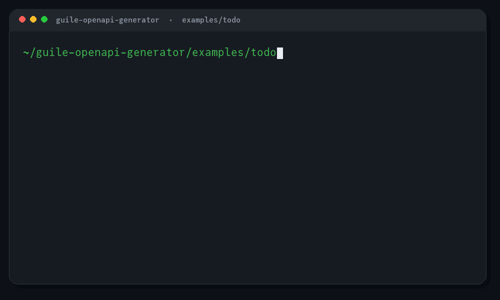

#+title: Guile OpenAPI Generator
#+subtitle: Write the specification once; get Guile you would have written by hand.
#+author: Josep Bigorra
#+email: jjbigorra@gmail.com
#+language: en
#+options: toc:nil

[[https://jointhefreeworld.org/ggg/dist/scheme-guile.svg]] [[https://jointhefreeworld.org/ggg/dist/gnu-guix.svg]] [[https://jointhefreeworld.org/ggg/dist/maak.svg]]
[[https://jointhefreeworld.org/ggg/dist/license-mit.svg]] [[https://img.shields.io/badge/docs%20license-CC%20BY%204.0-2ea44f.svg]] [[https://img.shields.io/badge/CI-Byggsteg%20%7C%20GitHub-2ea44f.svg]]

#+attr_html: :width 160 :alt Guile OpenAPI Generator logo

#+caption: A real =./run.sh demo= run from =examples/todo=.
#+attr_html: :width 900 :alt Terminal demo: one command generates, serves, calls and stops the Todo API

#+begin_quote
*Write the specification once; get Guile you would have written by hand.*
#+end_quote

Turn an OpenAPI 3.x specification — YAML or JSON — into Guile Scheme that reads
like a person wrote it: records that validate themselves, a controller with a
route table and a dispatcher, and an HTTP client whose procedures take and return
records rather than strings.

Welcome!  The manual lives in [[file:docs/index.org][docs/]] and is split by task, so you can read
only the part you need:

| Page                                                | What it covers                                                |
|-----------------------------------------------------+---------------------------------------------------------------|
| [[file:docs/index.org][Documentation home]]                             | every page, in reading order                                  |
| [[file:docs/overview.org][Overview and features]]                       | what the generator does and why                               |
| [[file:docs/install.org][Install]]                                     | Guix, Nix, containers and distribution packages                |
| [[file:docs/quick-start.org][Quick start]]                             | generate, use the models, call the API                        |
| [[file:docs/guide.org][Build a complete app]]                      | specification to running server, step by step                  |
| [[file:docs/cli.org][The command line]]                          | every option, the config file and the =spec= command           |
| [[file:docs/spec.org][From routes to a specification]]           | the other direction: existing servers to OpenAPI              |
| [[file:docs/generated-code.org][What gets generated]]                       | models, controllers, client, authentication, errors            |
| [[file:docs/internals.org][Inside the generator]]                       | the pipeline and where to change what                          |
| [[file:docs/reference.org][Reference and development]]                  | the Scheme API, tests, contributing, licence                   |

It is for Guile developers who have an API description and would rather not
hand-write a hundred accessors, converters and status checks; and for teams that
want the boring, error-prone half of an API client generated, while the
interesting half stays ordinary Scheme they can read, edit and debug.

[[file:examples/todo/README.org][=examples/todo/=]] is a complete, runnable application: one specification, a
generated tree, and the handful of handlers that make it real.

If you like my work, please support me by [[https://bmc.link/jjbigorra][buying me a cup of coffee ☕]] so I can
continue with a lot of motivation.

* Licence
MIT.  See [[file:LICENSE][LICENSE]].
