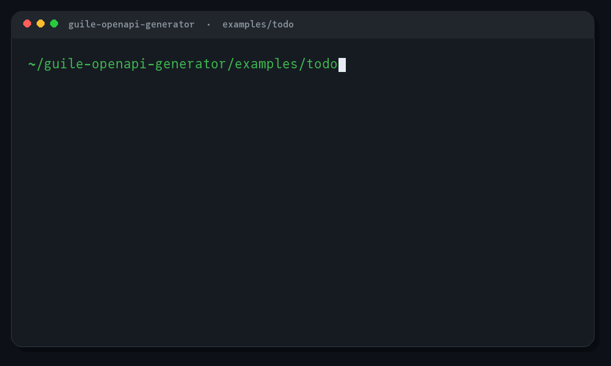

#+title: Guile OpenAPI Generator
#+subtitle: Write the specification once; get Guile you would have written by hand.
#+author: Josep Bigorra
#+email: jjbigorra@gmail.com
#+language: en
#+options: toc:nil

[[https://jointhefreeworld.org/ggg/dist/scheme-guile.svg]] [[https://jointhefreeworld.org/ggg/dist/gnu-guix.svg]] [[https://jointhefreeworld.org/ggg/dist/maak.svg]]
[[https://jointhefreeworld.org/ggg/dist/license-agpl3+.svg]] [[https://jointhefreeworld.org/ggg/dist/license-fdl13+.svg]]

#+caption: A real =./run.sh demo= run from =examples/todo=.
#+attr_html: :width 900 :alt Terminal demo: one command generates, serves, calls and stops the Todo API

#+begin_quote
*Write the specification once; get Guile you would have written by hand.*
#+end_quote

Turn an OpenAPI 3.x specification — YAML or JSON — into Guile Scheme that reads
like a person wrote it: records that validate themselves, a controller with a
route table and a dispatcher, and an HTTP client whose procedures take and return
records rather than strings.

Welcome! Whether you are evaluating the project, generating your first client,
or looking for a friendly place to contribute, this README is meant to take you
from “I have a spec” to “I have something running” without surprises.  New
here?  The [[file:examples/todo/README.org][Todo example]] is a complete app you can run with one command, and
the animation above is its real output.

It is for Guile developers who have an API description and would rather not
hand-write a hundred accessors, converters and status checks; and for teams that
want the boring, error-prone half of an API client generated, while the
interesting half stays ordinary Scheme they can read, edit and debug.

If you like my work, please support me by [[https://bmc.link/jjbigorra][buying me a cup of coffee ☕]] so I can
continue with a lot of motivation.

* Why you'll like it
:PROPERTIES:
:CUSTOM_ID: why-you-ll-like-it
:END:

** The five-second version
:PROPERTIES:
:CUSTOM_ID: the-five-second-version
:END:

| You have…                    | You want…                      | You get…                                                                    |
|------------------------------+--------------------------------+-----------------------------------------------------------------------------|
| a schema                     | data models                    | records, a keyword constructor that validates, =->jso= / =jso->= converters |
| paths and operations         | a server                       | a route table, a dispatcher, and one procedure per operation                |
| a new application            | a running API in minutes       | =guile-handler=, which adapts Guile's =run-server= to the dispatcher        |
| an existing Artanis app      | routes registered for you      | an adapter that registers every route, if you ask for it                    |
| routes you already wrote     | a specification                | an OpenAPI 3.0 YAML document, with the paths and operations read back       |
| a remote API                 | a client                       | one procedure per operation, plain Guile or libcurl                         |
| a tool that vendors its deps | a tree that needs nothing else | =--self-contained=, which copies the runtime next to the code               |

#+begin_src scheme
;; The whole idea, in four lines:
(define rex (make-pet #:id 7 #:name "Rex" #:status "sold"))
(pet-name rex)                     ;; => "Rex"
(pet->jso rex)                     ;; => (("id" . 7) ("name" . "Rex") ("status" . "sold"))
(pet-valid? rex)                   ;; => #t
#+end_src

#+TOC: headlines 1

** Choose your path
:PROPERTIES:
:CUSTOM_ID: choose-your-path
:END:

| If you want to…                       | Start here                       |
|---------------------------------------+----------------------------------|
| Try it in under a minute              | [[#quick-start][Quick start]]                      |
| Build a complete server               | [[#build-a-complete-app][Build a complete app]]             |
| Understand the generated code         | [[#what-gets-generated][What gets generated]]              |
| Generate a client for an existing API | [[#quick-start][Quick start]], then [[#authentication][Authentication]] |
| Turn routes you already have into a spec | [[#from-routes-to-a-specification][From routes to a specification]] |
| Call the library from your own code   | [[#reference][Reference]]                          |
| Understand the pipeline               | [[#inside-the-generator][Inside the generator]]             |
| Contribute a fix or a feature         | [[#development][Development]]                      |
| See the philosophy                    | [[#how-the-generator-is-written][How the generator is written]]     |
| Run the bundled example               | [[file:examples/todo/README.org][=examples/todo/=]]                 |

** Who it is for
:PROPERTIES:
:CUSTOM_ID: who-it-is-for
:END:

Guile OpenAPI Generator is a good fit if you:

- already describe your API with OpenAPI and want the Guile side to follow;
- are building a small service with Guile's own web server or Artanis;
- want a generated client that feels hand-written, with docstrings, keyword
  arguments and records instead of stringly-typed maps;
- care about reproducible builds, free software and code you can read;
- are curious about how far a specification can take you.

It is deliberately not a multi-language code factory, and it is not a runtime
framework. It generates ordinary Guile modules; from there, the application is
yours.

And it is Guile all the way down: records, keyword arguments, parameters,
=receive=, ports, and a YAML reader written in Scheme.  The generated code is
meant to look like the code you would have written, not like a template in
another language.

* Features
:PROPERTIES:
:CUSTOM_ID: features
:END:

- *A YAML reader written in Scheme.* No libyaml, no FFI: block and flow
  collections, quoted and block scalars, anchors and merge keys, comments and
  document markers. JSON goes through [[https://github.com/aconchillo/guile-json][guile-json]].
- *Models that cannot hold a wrong value.* A constructor either returns a record
  that satisfies every constraint the specification declares, or throws
  =openapi-validation-error= naming the field at fault. =(pet? value)= tells you
  the shape, =(pet-valid? value)= tells you the constraints.
- *Polymorphism, honestly.* =allOf= (inheritance) is flattened into one record,
  so a =Cat= has the =Pet= members; =oneOf= and =anyOf= become a predicate plus
  a decoder that dispatches on the discriminator, or on the shape of the node when
  there is none.  A discriminator declared on the composition parent is inherited
  by the =oneOf= that collects its children.
- *Directional models.* =readOnly= and =writeOnly= are understood: one model set
  keeps them optional, =--exclude-read-only=/=--exclude-write-only= drop one
  category, and =--request-response-models= emits a =Request= and a =Response=
  set with exactly the members each direction can carry.
- *Enumerations that can grow.* =--x-extensible-enums= treats an extensible enum
  as an enumeration, and =--fault-tolerant-enums= maps a value the specification
  did not list to =unrecognized= instead of failing the record.
- *Keyword constructors.* =(make-pet #:id 7 #:name "Rex")= — a schema with
  eleven properties is unreadable with positional arguments, and a missing
  required one is reported by name.
- *Controllers without a framework, or with Artanis.* The portable module matches
  a request against a route table and looks the handler up in =api-handlers=;
  =guile-handler= plugs that dispatcher straight into Guile's =run-server=.  The
  Artanis adapter is a thin translation layer over the same code.
- *Two HTTP clients, one shape.* =client-send= is the only procedure that differs
  between plain Guile (=(web client)=) and libcurl (=guile-curl=); credentials,
  URL building, status checking and decoding are shared.  The media type the
  specification declares decides whether a body is JSON, text, a form, multipart
  or bytes, and the same rule decodes the response.
- *Auth from the specification.* The security schemes become a literal alist, each
  operation carries the requirements that authorise it, and =authenticate= turns
  an =<auth>= into the headers and query parameters that express it.
- *JSON merge patch (RFC 7386) built in.* Every record has an =…-apply-patch=
  procedure, and the runtime ships =json-merge-patch= for plain data.
- *Generated code you can read.* Docstrings, kebab-case names, aligned argument
  lists, and a header saying where the file came from. The tests assert on the
  text as well as on the behaviour, because a generated file is also
  documentation.
- *Generated by building code, not by gluing strings.* The emitters construct
  s-expressions with quasiquote and a small renderer decides indentation, line
  breaks and wrapping — so a generator reads like the code it writes.
- *The other direction, for code that came first.* Routes written in Scheme, or
  declared in an Artanis application, become an OpenAPI 3.0 YAML document: the
  paths, the operations, the path parameters and the media types the source
  already implies, so an existing app can grow the specification it never had.
  One command (=openapi-generator spec=) if you want the file, three modules if
  you want it in memory.

* Ways to install
:PROPERTIES:
:CUSTOM_ID: ways-to-install
:END:

/Four routes to the same 0.0.7, from the most automated to the most manual.  They all build the tag this README documents./

** From the Guix channel
:PROPERTIES:
:CUSTOM_ID: from-the-guix-channel
:END:
*GNU Guix* is the functional package manager this project is developed with: a build is a pure function of its inputs, so the same recipe gives the same result everywhere, and an upgrade that goes wrong can be rolled back.

The jointhefreeworld channel carries ~guile-openapi-generator~ at 0.0.7, so a checkout of the channel is enough — no package definition to write:

#+begin_src shell
git clone https://codeberg.org/jjba23/guix-jointhefreeworld.git
guix install -L ./guix-jointhefreeworld guile-openapi-generator
#+end_src

Add the channel to ~$HOME/.config/guix/channels.scm~ (the channel's README has the four lines) and a plain ~guix install guile-openapi-generator~ keeps working on every later ~guix pull~.

** From the Nix flake
:PROPERTIES:
:CUSTOM_ID: from-the-nix-flake
:END:
*Nix* offers the same declarative, reproducible model with its own language, its own store and a binary cache, and it is a natural fit if the rest of your machine is already described in Nix.

This project is not in the flake yet; the flake builds the projects that carry a Nix expression of their own.

** As a container image
:PROPERTIES:
:CUSTOM_ID: as-a-container-image
:END:
*Podman or Docker* is the route that puts nothing on the host: the ~Dockerfile~ builds the project in a builder stage that installs it with the same installer the distribution recipes run (=scripts/install-tree=) and smoke-tests the result, then copies only that tree into a runtime stage, so the image is small and the host keeps its own toolchain untouched.

#+begin_src shell
podman build -t guile-openapi-generator .   # docker build -t guile-openapi-generator . also works

# Generate a tree into the current directory
podman run --rm -v "$PWD:/work" guile-openapi-generator \
    generate -i openapi.yaml -o gen -m petstore

# Recover a specification, straight to standard output
podman run --rm -v "$PWD:/work" guile-openapi-generator \
    spec -i app/controllers.scm -o -
#+end_src

The entry point is the installed command, the working directory is =/work=, and
=none= mounted is enough for =--help= or =--version=:

#+begin_src shell
podman run --rm guile-openapi-generator --help
#+end_src

The image holds the launcher, the manual page and the byte-compiled library, in
the same layout the packages install — it comes from the same script, not from a
second description of it — and the build fails if the staged tree cannot
generate a specification or recover one.  Building with
=--build-arg VERSION=X.Y.Z= also makes the image check that label against
~guile-openapi-generator --version=, so a tag cannot hold different code.  A bug
that only shows up in a package can usually be reproduced here first.

** As a distribution package
:PROPERTIES:
:CUSTOM_ID: as-a-distribution-package
:END:
*Debian, openSUSE and Arch* each get the project through their own package manager.  Packaging lives in this repository under ~packaging/~ — the recipes, the tests they run and the release steps are written down in [[file:packaging/README.org][=packaging/README.org=]] — and is pinned to the same release tag, so the recipes and the sources they build are versioned together.

Every package installs the same five things: =/usr/bin/guile-openapi-generator=
(the launcher), the manual page, the library in Guile's site directory, its
byte-compiled copies in the site-ccache directory, and the licence and README
under =/usr/share=.  All four recipes — the three distributions and the
container — get that layout from one script, =scripts/install-tree=, instead of
repeating it, and both Guile directories are asked of Guile rather than
hard-coded, because they differ between distributions and architectures.

None of the three archives ships guile-openapi-generator yet, so these are recipes to build rather than packages to install from a mirror:

| Distribution   | Package                   | How to build it                                                        |
|----------------+---------------------------+------------------------------------------------------------------------|
| Debian, Ubuntu | ~guile-openapi-generator~ | ~maak package-deb~ (or copy ~packaging/debian~ to the root and ~dpkg-buildpackage -us -uc -b~) |
| openSUSE       | ~guile-openapi-generator~ | ~maak package-rpm~, or ~osc build~ with ~packaging/opensuse~          |
| Arch           | ~guile-openapi-generator~ | ~maak package-arch~ after ~updpkgsums~ in ~packaging/arch~             |
| Container      | =guile-openapi-generator= | ~maak package-docker~                                                  |

Each recipe carries its own dependency list, so a missing library fails the build with its name rather than producing a package that cannot load.  All of them run the test suite before they produce a package, and the Debian package also ships two autopkgtests: one that exercises the *installed* command — version, help, both directions — and one that checks the layout and the byte-compiled cache, which are the only checks that can see a file installed in the wrong place.

The part all four share is testable on any machine: ~maak package-smoke= installs the tree into =dist/root= with =scripts/install-tree= and runs both commands from there, so a layout bug does not need a build chroot to show up.

** Which one?
:PROPERTIES:
:CUSTOM_ID: which-one
:END:
- *Guix* if you want the toolchain the project is tested with, and the ability to roll back a bad upgrade.
- *Nix* if the rest of your machine is already declarative; this flake does not carry the project yet, but the container image and the recipes below do.
- *Container* if you only want to try the release, or reproduce a report on a machine that has nothing installed.
- *Distribution package* if you want the project managed by the same tool as the rest of your system, with its licence, manual page and launcher in the usual places.

* Install
:PROPERTIES:
:CUSTOM_ID: install
:END:

The generator is a library first and a command second.  You can use it from a
checkout without installing anything; Guix simply makes the environment
reproducible.

** With Guix (recommended)
:PROPERTIES:
:CUSTOM_ID: with-guix-recommended
:END:

From this repository, which packages the working tree:

#+begin_src shell
guix shell -f guix.scm -- guile -L ./src \
  -c '(use-modules (openapi-generator)) (display "ready\n")'
#+end_src

The development environment, pinned in =channels.scm=, has Guile, guile-json,
guile-curl, Veritas and the documentation tooling:

#+begin_src shell
guix shell -m manifest.scm -- guile -L ./src \
  -c '(use-modules (openapi-generator)) (display "ready\n")'
#+end_src

Everything is pinned, so a local run and a CI run resolve the same packages:

#+begin_src shell
guix time-machine --channels=channels.scm -- shell -m manifest.scm -- \
  guile -L ./src -c '(use-modules (openapi-generator)) (display "ready\n")'
#+end_src

** With any Guile
:PROPERTIES:
:CUSTOM_ID: with-any-guile
:END:

Any Guile 3.0 with guile-json on the load path is enough:

#+begin_src shell
git clone https://codeberg.org/jjba23/guile-openapi-generator
cd guile-openapi-generator
guile -L ./src -c '(use-modules (openapi-generator)) (display "ready\n")'
#+end_src

If you only want to generate a tree and not develop the generator, this is
enough; put =src/= on the load path whenever you run the generator, or use
=--self-contained= so the generated tree carries its own runtime.

From the checkout, =./scripts/guile-openapi-generator= runs the same command the
packages install.  The launcher looks for the library beside itself, so it needs
no environment variable:

#+begin_src shell
./scripts/guile-openapi-generator generate -i examples/petstore.yaml -o gen
./scripts/guile-openapi-generator spec -i app/controllers.scm -o openapi.yaml
#+end_src

** Requirements
:PROPERTIES:
:CUSTOM_ID: requirements
:END:

| Requirement | Version | Needed for                                                 |
|-------------+---------+------------------------------------------------------------|
| GNU Guile   |    3.0+ | the generator and everything it generates                  |
| guile-json  |     4.x | JSON reading and writing, in the generator and at run time |
| guile-curl  |     0.9 | generated libcurl clients only                             |
| Artanis     |     1.x | generated Artanis adapters only                            |
| Veritas     |    0.8+ | this project's tests only                                  |
| maak        |     any | the developer tasks (=maak test=, =maak check=, …)         |

** Verify the install
:PROPERTIES:
:CUSTOM_ID: verify-the-install
:END:

A successful load prints =ready= and exits quietly:

#+begin_src shell
guile -L ./src -c '(use-modules (openapi-generator)) (display "ready\n")'
#+end_src

If that works, you are ready for the quick start.  If it does not, the error
usually names the missing module or the wrong load path, and the
[[#requirements][requirements table]] above is the place to look first.

* Quick start
:PROPERTIES:
:CUSTOM_ID: quick-start
:END:

Sixty seconds from a specification to running code.  All commands below assume
you are in the root of a checkout of this repository.

** Generate
:PROPERTIES:
:CUSTOM_ID: generate
:END:

#+begin_src shell
guile -L ./src -c '((@ (openapi-generator cli) main!)
                    (list "generate" "--input" "examples/petstore.yaml"
                          "--output" "gen" "--module" "petstore"))'
#+end_src

That writes

#+begin_example
gen/petstore/models.scm        records, validations, converters
gen/petstore/controllers.scm   route table and dispatcher
gen/petstore/client.scm        one procedure per operation
gen/petstore/README.org        what was generated, and how to use it
#+end_example

Ask for an Artanis adapter and a libcurl client with two flags:

#+begin_src shell
guile -L ./src -c '((@ (openapi-generator cli) main!)
                    (list "generate" "-i" "examples/petstore.yaml" "-o" "gen"
                          "--module" "petstore"
                          "--controllers" "artanis" "--http" "curl"))'
#+end_src

** Use the models
:PROPERTIES:
:CUSTOM_ID: use-the-models
:END:

#+begin_src scheme
(use-modules (petstore models))

(define rex (make-pet #:id 7 #:name "Rex" #:status "sold"))

(pet-name rex)          ;; => "Rex"
(pet-valid? rex)        ;; => #t
(pet->jso rex)          ;; => (("id" . 7) ("name" . "Rex") ("status" . "sold"))
(jso->pet (pet->jso rex))

;; A constraint the specification declares is enforced by the constructor:
(catch 'openapi-validation-error
  (lambda () (make-pet #:id 7 #:name ""))
  (lambda (key path message)
    (format #t "~a: ~a~%" path message)))
;; => (pet name): must be at least 1 characters long
#+end_src

** Call the API
:PROPERTIES:
:CUSTOM_ID: call-the-api
:END:

#+begin_src scheme
(use-modules (petstore client)
             (openapi-generator runtime))

(define client (make-api-client
                #:base-url "https://api.example.com/v1"
                #:auth (make-auth #:api-keys '(("api_key" . "secret")))))

(receive (pets response)
    (list-pets client #:limit 10)
  (map pet-name pets))          ; two values: the decoded body and the response
#+end_src

** Serve it
:PROPERTIES:
:CUSTOM_ID: serve-it
:END:

Vanilla controllers export =guile-handler=, a ready adapter for Guile's own
=run-server=:

#+begin_src scheme
(use-modules (web server)
             (petstore controllers)
             (openapi-generator runtime))

(parameterize ((api-handlers
                (list (cons 'list-pets
                            (lambda (request arguments)
                              (ok '#()))))))
  (run-server (guile-handler) 'http '(#:host "127.0.0.1" #:port 8080)))
#+end_src

If you are embedding the dispatcher in a test or another server, call =dispatch=
directly with an =<http-request>=:

#+begin_src scheme
(parameterize ((api-handlers
                (list (cons 'list-pets
                            (lambda (request arguments)
                              (ok (map pet->jso pets)))))))
  (dispatch (make-http-request 'GET "/pets" '(("limit" . "10")) '() #f)))
;; => an <http-response> with status 200 and the pets as its body
#+end_src

With Artanis, the adapter registers everything for you:

#+begin_src scheme
(use-modules (petstore controllers artanis))
(register-routes!)
#+end_src

** Next steps
:PROPERTIES:
:CUSTOM_ID: next-steps
:END:

- Want a complete, runnable server?  Follow [[#build-a-complete-app][Build a complete app]].
- Want a client only?  Skip the controllers and ask for
  =--targets models,client=.
- Want to keep the options with the project?  Add an
  [[#configuration-file][=openapi-generator.yaml=]] and generate with =--config=.
- Want to vendor the runtime?  Add =--self-contained=.

* Build a complete app
:PROPERTIES:
:CUSTOM_ID: build-a-complete-app
:END:

[[file:examples/todo/README.org][=examples/todo/=]] is a complete, runnable application: one specification, a
generated tree, an in-memory store, four handlers and a client.  From a clone:

#+begin_src shell
cd examples/todo
./run.sh demo
#+end_src

That generates the code, serves the API on =http://127.0.0.1:8080=, calls it
with the generated client, and stops the server.  The rest of this section is
what the example does, so you can build the same shape for your own API.

The example is also the source of the animation at the top of this README: it is
a real run, not a mock-up.

** Describe the API
:PROPERTIES:
:CUSTOM_ID: describe-the-api
:END:

Write an OpenAPI document.  The example's =openapi.yaml= has a collection and an
item route:

#+begin_src yaml
paths:
  /todos:
    get:
      operationId: listTodos
      responses:
        '200':
          content:
            application/json:
              schema:
                type: array
                items: {$ref: '#/components/schemas/Todo'}
    post:
      operationId: createTodo
      requestBody:
        required: true
        content:
          application/json:
            schema: {$ref: '#/components/schemas/NewTodo'}
      responses:
        '201':
          content:
            application/json:
              schema: {$ref: '#/components/schemas/Todo'}
#+end_src

** Generate once
:PROPERTIES:
:CUSTOM_ID: generate-once
:END:

Put the options in a checked-in file so every build agrees:

#+begin_src yaml
# openapi-generator.yaml
input: openapi.yaml
output: gen
module: todo
controllers: vanilla
http: guile
#+end_src

#+begin_src shell
guile -L ../../src -c '((@ (openapi-generator cli) main!)
                        (list "generate" "--config" "openapi-generator.yaml"))'
#+end_src

The tree is ordinary source: =gen/todo/models.scm=, =controllers.scm=,
=client.scm= and a =README.org= that lists the operations and the next steps.
Regenerate whenever the specification changes; edit the application, not =gen/=.

** Write the handlers
:PROPERTIES:
:CUSTOM_ID: write-the-handlers
:END:

A controller handler receives the request and an alist of decoded arguments.  A
path parameter is an integer, a query parameter is decoded, and a request body is
already a validated record:

#+begin_src scheme
(use-modules (ice-9 format)
             (srfi srfi-1)
             (web server)
             (openapi-generator runtime)
             (todo controllers)
             (todo models))

(define todos
  (list (make-todo #:id 1 #:title "Read the generated README" #:done #t)))

(define (create-todo-handler request arguments)
  (let* ((new (cdr (assq 'body arguments)))          ; a <new-todo>
         (todo (make-todo #:id 2
                          #:title (new-todo-title new)
                          #:done (or (new-todo-done new) #f))))
    (set! todos (cons todo todos))
    (created (todo->jso todo))))

(define (get-todo-handler request arguments)
  (let ((todo (find (lambda (todo)
                      (= (todo-id todo) (cdr (assq 'id arguments))))
                    todos)))
    (if todo
        (ok (todo->jso todo))
        (not-found "No such todo"))))
#+end_src

Return a response with =ok=, =created=, =no-content=, =text-response=,
=binary-response= or =error-response=.  JSON bodies are serialised for you;
convert a record with its =->jso= procedure first.

** Serve it
:PROPERTIES:
:CUSTOM_ID: serve-it-2
:END:

Vanilla controllers export =guile-handler=, which adapts Guile's own
=run-server= to the generated dispatcher.  The complete server is:

#+begin_src scheme
(define handlers
  (list (cons 'list-todos
              (lambda (request arguments)
                (ok (list->vector (map todo->jso todos)))))
        (cons 'create-todo create-todo-handler)
        (cons 'get-todo get-todo-handler)))

(parameterize ((api-handlers handlers))
  (run-server (guile-handler) 'http '(#:host "127.0.0.1" #:port 8080)))
#+end_src

Handlers are looked up by the operation name in =api-handlers=; an operation
with no handler raises =openapi-not-implemented= instead of returning a
mysterious 500.  With Artanis, use =register-routes!= instead (see the quick
start above).

** Call it
:PROPERTIES:
:CUSTOM_ID: call-it
:END:

#+begin_src shell
curl http://127.0.0.1:8080/todos
curl -X POST http://127.0.0.1:8080/todos \
     -H 'Content-Type: application/json' -d '{"title":"Ship it"}'
#+end_src

or use the generated client, which returns the decoded body and the response:

#+begin_src scheme
(use-modules (ice-9 receive)
             (todo client)
             (todo models))

(define client (make-api-client))          ; starts from the spec's server URL

(receive (todo response)
    (create-todo client
                 #:body (make-new-todo #:title "Ship it" #:done #f))
  (format #t "created #~a: ~a~%" (todo-id todo) (todo-title todo)))
#+end_src

** Package it
:PROPERTIES:
:CUSTOM_ID: package-it
:END:

- =--self-contained= copies the runtime modules next to the generated code, so
  the application needs only Guile and guile-json.
- =--dependencies guix= writes a =dependencies.scm= manifest for
  =guix shell -m=.
- =--targets models= generates only the data shapes, for documentation or a
  shared library; a client or controller target always brings the models it
  needs.

When the specification grows, add the route to =openapi.yaml=, regenerate, and
add a handler.  The generated =README.org= and the compiler tell you the
procedure and record names for the new operation.

* The command line
:PROPERTIES:
:CUSTOM_ID: the-command-line
:END:

#+begin_example
guile-openapi-generator 0.1.0

Usage: openapi-generator generate --input SPEC --output DIR [options]

  --help (-h)                   Show this help and exit.
  --version (-v)                Show the version and exit.
  --config VALUE                Read options from a YAML or JSON file; flags override it.
  --input (-i) VALUE            The OpenAPI 3.x specification to read (.yaml or .json).
  --output (-o) VALUE           The directory to write the generated code to.
  --module (-m) VALUE           The root module name (default: the API title).
  --targets (-t) VALUE          Comma-separated: models, controllers, client, readme.
  --controllers (-c) VALUE      vanilla, artanis or none (default: vanilla).
  --http (-H) VALUE             guile, curl or none (default: guile).
  --no-models                   Generate no record module.
  --model-suffix VALUE          Append SUFFIX to every generated model name.
  --operation-id-transform VALUE Rename operationIds as REGEX:REPLACEMENT.
  --base-url VALUE              Override the first server URL of the specification.
  --self-contained              Copy the runtime modules next to the generated code.
  --no-validate                 Do not check that the input is OpenAPI 3.x.
  --no-header                   Omit the banner comment from generated files.
  --header-file VALUE           Add the contents of FILE to the generated banner.
  --dependencies VALUE          none or guix: write a dependencies.scm manifest.
  --json-schema-file VALUE      Read a JSON Schema document instead of an OpenAPI spec.
  --json-schema-root-name VALUE Name the schema generated from a JSON Schema's top level.
  --api-fragment VALUE          Merge a partial OpenAPI document into the primary one.
  --auth VALUE                  Send 'Name: value' on remote fetches; repeatable.
  --resolve-external VALUE      none, targeted or aggressive external $ref resolution.
  --request-response-models     Emit Request and Response model sets.
  --exclude-read-only           Drop readOnly properties from the single model set.
  --exclude-write-only          Drop writeOnly properties from the single model set.
  --x-extensible-enums          Treat x-extensible-enum(s) as enumerations.
  --fault-tolerant-enums        Map unknown string enum values to 'unrecognized'.
  --non-null-response-payloads  Fail when a declared success body is missing or null.
#+end_example

An unknown value is an error rather than a silent fallback: a typo in
=--controllers artanis= should not leave you with a plain Guile server.

** The other direction: =spec=
:PROPERTIES:
:CUSTOM_ID: the-other-direction-spec
:END:

The second command reads the routes of a server you already have and writes an
OpenAPI 3.0 document.  Nothing is loaded and no handler runs: the source is read
as data (see [[#from-routes-to-a-specification][From routes to a specification]] for what is recognised).

#+begin_example
Usage: openapi-generator spec --input ROUTES --output FILE [options]

  --help (-h)                 Show this help and exit.
  --input (-i) VALUE          The Guile or Artanis source file whose routes are read.
  --output (-o) VALUE         The YAML file to write, or - for standard output.
  --source (-s) VALUE         guile or artanis (default: guile).
  --title (-t) VALUE          The info.title of the document (default: API).
  --api-version (-V) VALUE    The info.version of the document (default: 1.0.0).
  --version (-v)              Show the version and exit.
  --description VALUE         The info.description of the document.
  --server VALUE              A servers entry; repeatable.
#+end_example

#+begin_src shell
# A Guile server: the route table this generator writes, or plain (get ...) forms
openapi-generator spec -i app/controllers.scm -o openapi.yaml

# An Artanis application: :params, #:consumes, #:produces and #:with-auth
openapi-generator spec -i app/routes.scm -s artanis -t 'My API' \
    --api-version 2.0.0 --server https://api.example.com/v1 -o openapi.yaml

# Straight to a terminal, or into the next generation run
openapi-generator spec -i app/controllers.scm -o - | less
#+end_src

The output is the same document =routes->yaml-file= writes, so the two routes
into the feature are interchangeable: use the command when a build should produce
the file, and the modules when a program should hold it in memory.

The exit status is 0 when a document was written and 1 when it was not, with the
reason on standard error: a missing file, an unknown =--source=, a source with no
routes at all, or two routes that would produce the same operation.  A document
is never written from a guess.

** Configuration file
:PROPERTIES:
:CUSTOM_ID: configuration-file
:END:

A checked-in file can carry the options a project always uses.  It is YAML or
JSON, keys are normalised so =baseUrl=, =base_url= and =base-url= are the same
option, and a command-line flag overrides the file:

#+begin_src yaml
input: api/openapi.yaml
output: gen
module: petstore
targets: [models, client]
modelSuffix: Dto
operation-id-transform: '^V2_(.*)$:v2-\1'
resolve-external: targeted
auth: ['Authorization: Bearer ${API_TOKEN}']
requestResponseModels: true
fault-tolerant-enums: true
nonNullResponsePayloads: true
header: true
header-file: LICENSE-HEADER.txt
dependencies: guix
#+end_src

#+begin_src shell
guile -L ./src -c '((@ (openapi-generator cli) main!)
                    (list "generate" "--config" "openapi-generator.yaml"))'
#+end_src

=--targets= is what makes the file useful to more than one consumer: a build can
generate only =models= for documentation, or =models,client= for an application,
without changing the rest of the configuration.  Generating a client or a
controller always brings the models those need.  =--dependencies guix= writes a
=dependencies.scm= manifest for =guix shell -m=, and =--no-header= /
=--header-file= control the banner every generated file starts with.

** Inputs and references
:PROPERTIES:
:CUSTOM_ID: inputs-and-references
:END:

- *Remote specifications.* =--input= accepts an http(s) URL as well as a path.
  =--auth 'Name: value'= sends a header on every fetch (the input, every
  =--api-fragment=, and every remote =$ref=); it is repeatable and expands
  =${ENV_VAR}= from the environment.  A missing variable is an error, not an
  empty credential.
- *Fragments.* =--api-fragment FILE= merges a partial OpenAPI document into the
  primary one.  Objects merge key by key and a key the fragment defines wins, so
  a fragment can add paths and schemas without rewriting the base document.  The
  option is repeatable.
- *External references.* =--resolve-external targeted= follows the =$ref=s the
  primary document reaches and copies each target into
  =components/<type>/<name>=, rewriting the reference.  =aggressive= also adds
  every schema of an external file as soon as one reference has caused that file
  to be read.  Relative references resolve against the document that contains
  them, cycles are fine, and a name already taken by the primary document gains
  a =-2= suffix.  The default, =none=, leaves external references alone.
- *JSON Schema.* =--json-schema-file FILE= takes a JSON Schema document instead
  of an OpenAPI one.  The top-level schema becomes a component named by
  =--json-schema-root-name= (or its =title=), =$defs=/=definitions= are hoisted
  into =components/schemas= with their references rewritten, draft-04 boolean
  exclusive bounds become numeric, and =const= becomes a one-value enumeration.
  =FILE#/pointer= selects a schema nested inside a larger document.
- *Server variables.* A server URL such as
  =https://{region}.example.com/{version}= is expanded with each variable's
  declared default, so the generated client starts from a usable base URL.

** Directional models and enumerations
:PROPERTIES:
:CUSTOM_ID: directional-models-and-enumerations
:END:

OpenAPI marks a property =readOnly= when only a response carries it, and
=writeOnly= when only a request does.  The default remains one model set, and a
directional member is optional there because a single record cannot satisfy both
directions; =--exclude-read-only= and =--exclude-write-only= drop one category
instead.

=--request-response-models= emits two sets in one module.  Component names gain
=Request=/=Response= after any =--model-suffix=, and the members each direction
cannot carry are gone: a request model has no =readOnly= property, a response
model no =writeOnly= one.  The generated client sends request models and decodes
response models; the controllers decode request models.  A nested inline model
keeps the suffix of the component it belongs to (=PetRequest-detail=), so the
two sets never share a definition.

=--x-extensible-enums= treats =x-extensible-enum= (and the plural spelling) as an
enumeration; by default the extension is ignored, because an extensible enum is
supposed to tolerate values the specification does not list.  For the same
reason, =--fault-tolerant-enums= gives a string enumeration an =unrecognized=
value and maps unknown strings to it, so a server that adds a value does not take
the whole record down; without it an unknown value still fails validation.

A discriminator does not have to be repeated on the =oneOf= that collects the
children: when it is declared on the parent they share through =allOf=, the
generated union decoder finds it there.

** Media types and response headers
:PROPERTIES:
:CUSTOM_ID: media-types-and-response-headers
:END:

The media type a request or response declares decides how its body is encoded,
and the generated client and controllers follow it:

| Media type                          | Request                                                          | Response               |
|-------------------------------------+------------------------------------------------------------------+------------------------|
| =application/json=, =+json=         | a record as JSON                                                 | decoded as JSON        |
| =text/plain=                        | a string                                                         | a string               |
| =application/x-www-form-urlencoded= | an object as form fields                                         | decoded as form fields |
| =multipart/form-data=               | a record as parts; a string with =format: binary= is a file part | raw bytes              |
| anything else                       | bytes                                                            | bytes                  |

A form body is encoded with =form-string=: strings pass through, numbers print
as numbers and booleans as =true= or =false=.  A controller parses it with
=parse-query= and then coerces each declared =integer=, =number= or =boolean=
field, so a form field declared as an integer arrives in the record as an
integer, and one that does not parse is left as the string it came in as, for
validation to report.  A form response is parsed with =parse-query= before the
record decoder sees it.  A multipart request is built by the client with a
boundary that is the same in the body and in the =Content-Type= header, as a
bytevector, so a binary part is not damaged by a text round-trip; a controller
parses the parts with =parse-multipart-body= and coerces them the same way.

Media types are negotiated rather than guessed.  The client sends =Accept= as
the declared response types in preference order — JSON, then text, then form,
then multipart, then everything else, with declaration order breaking ties — and
decodes the response by the =Content-Type= it actually received.  A controller
does the same for requests: the actual request =Content-Type= picks the declared
media type to decode, so a client that sends text to an operation that also
accepts JSON is understood instead of being fed to a JSON parser.

The comparison is on the media type's *essence*: its declared name, lower case,
with any =; charset=utf-8= parameter ignored, and compared exactly rather than
searched for.  That matters as soon as one operation declares more than one
=+json= type, which is what a Kubernetes patch does:

#+begin_src yaml
requestBody:
  content:
    application/json-patch+json:            # an array of operations
      schema: {type: array, items: {type: object}}
    application/merge-patch+json:           # a Pod
      schema: {$ref: '#/components/schemas/io.k8s.api.core.v1.Pod'}
    application/strategic-merge-patch+json: # a Pod, merged field by field
      schema: {$ref: '#/components/schemas/io.k8s.api.core.v1.Pod'}
#+end_src

All three contain the word =json=; a search for it would send every patch to the
first branch.  Each one is therefore matched by name, and the handler receives
the shape its own media type declares: the JSON Patch body arrives as a list of
alists, the merge patch as a validated =<io-k8s-api-core-v1-pod>= record.  A body
is decoded as its schema says and *validated* as one, because that is what the
specification claims a body of that media type is.

A body whose schema is not a named component — the JSON Patch array above is one
— is decoded by the shape itself, with the same expression the models use
internally, instead of calling a =jso->= converter that only exists for named
schemas.

The libcurl transport receives request bodies as bytevectors (guile-curl's
=postfields= accepts them) and reads the response as bytes, so binary uploads
and downloads never pass through a latin-1 string.

=--non-null-response-payloads= makes a declared success body mandatory: an empty
or null body raises =openapi-empty-body= instead of decoding to =#f=.  Declared
response headers are readable through a generated
=OPERATION-response-headers= helper, and the runtime offers =text-response=,
=binary-response= and =http-response-header= for handlers that need them.

** From Scheme instead
:PROPERTIES:
:CUSTOM_ID: from-scheme-instead
:END:

Every flag has a keyword argument, and the same run is a function call:

#+begin_src scheme
(use-modules (openapi-generator))

;; Returns ((models . "gen/petstore/models.scm")
;;          (controllers . "gen/petstore/controllers.scm")
;;          (client . "gen/petstore/client.scm")
;;          (readme . "gen/petstore/README.org"))
(generate-from-file "examples/petstore.yaml"
                    #:output "gen"
                    #:module "petstore"
                    #:controllers 'artanis
                    #:http 'curl
                    #:base-url "https://staging.example.com/v1"
                    #:self-contained? #t)

;; A document already in memory works the same way:
(generate-from-string yaml-text #:output "gen")
(generate #:document document #:output "gen" #:models? #f)
#+end_src

| Keyword                         | Default          | Meaning                                                    |
|---------------------------------+------------------+------------------------------------------------------------|
| =#:document=                    | —                | a parsed specification (exactly one of this and =#:input=) |
| =#:input=                       | —                | the file to read (.yaml or .json)                          |
| =#:output=                      | ="generated"=    | where the files go                                         |
| =#:module=                      | the API title    | the root module name                                       |
| =#:controllers=                 | ='vanilla=       | =vanilla=, =artanis= or =none=                             |
| =#:http=                        | ='guile=         | =guile=, =curl= or =none=                                  |
| =#:models?=                     | =#t=             | generate the record module                                 |
| =#:readme?=                     | =#t=             | generate the tree's README                                 |
| =#:base-url=                    | the first server | override the URL the client defaults to                    |
| =#:self-contained?=             | =#f=             | copy the runtime next to the generated code                |
| =#:validate?=                   | =#t=             | validate the specification before generating               |
| =#:model-suffix=                | =""=             | append a suffix to every generated model name              |
| =#:operation-id-transform=      | —                | a procedure or =REGEX:REPLACEMENT= applied to operationIds |
| =#:header?=                     | =#t=             | write the banner comment at the top of generated files     |
| =#:header-text=                 | —                | an extra banner paragraph (license or disclaimer)          |
| =#:dependencies=                | ='none=          | =none= or =guix= to write a =dependencies.scm= manifest    |
| =#:json-schema-file=            | —                | read a JSON Schema document instead of an OpenAPI one      |
| =#:json-schema-root-name=       | —                | name the schema generated from a JSON Schema's top level   |
| =#:api-fragments=               | ='()=            | partial OpenAPI documents merged into the primary one      |
| =#:headers=                     | ='()=            | headers sent on remote fetches and remote =$ref=s          |
| =#:resolve-external=            | ='none=          | =none=, =targeted= or =aggressive= external reference mode |
| =#:request-response-models?=    | =#f=             | emit separate Request and Response model sets              |
| =#:exclude-read-only?=          | =#f=             | drop readOnly properties from the single model set         |
| =#:exclude-write-only?=         | =#f=             | drop writeOnly properties from the single model set        |
| =#:x-extensible-enums?=         | =#f=             | treat x-extensible-enum(s) as enumerations                 |
| =#:fault-tolerant-enums?=       | =#f=             | map unknown string enum values to =unrecognized=           |
| =#:non-null-response-payloads?= | =#f=             | fail when a declared success body is missing or null       |

* From routes to a specification
:PROPERTIES:
:CUSTOM_ID: from-routes-to-a-specification
:END:

The generator reads a specification and writes Guile.  The same idea runs
backwards: an application that already has routes can describe them as OpenAPI
3.0, in YAML, and get the specification it never wrote — as a starting point to
refine, or as the input of the next generation run.

From a shell it is one command — =openapi-generator spec=, listed with the
other one in [[#the-other-direction-spec][the command line]] — and from Scheme it is three modules.
=(openapi-generator routes)= is the model (a route, its parameters, its request
body and its responses) plus the writer that turns a list of them into a
document.  =(openapi-generator guile-routes)= and
=(openapi-generator artanis-routes)= read routes out of source code and hand
that model back, so both ends stay in Scheme.

** A route, in Scheme

#+begin_src scheme
(use-modules (openapi-generator routes))

(define routes
  (list (route 'get "/pets"
               #:summary "List pets"
               #:tags '("pets")
               #:parameters (list (parameter "limit" #:in 'query #:type 'integer)))
        (route 'post "/pets"
               #:tags '("pets")
               #:request-body (request-body #:ref "#/components/schemas/NewPet")
               #:responses (list (response 201 #:ref "#/components/schemas/Pet")))
        (route 'get "/pets/{petId}"
               #:operation-id "getPet"
               #:responses (list (response 200 #:ref "#/components/schemas/Pet")
                                (response 404 #:description "No pet has that id")))))

(routes->yaml-file routes "openapi.yaml"
                    #:title "Pet store"
                    #:version "1.0.0"
                    #:servers '("https://api.example.com/v1")
                    #:schemas (list (cons "Pet" pet-schema)))
#+end_src

=routes->yaml-file= writes an OpenAPI 3.0.3 document; =routes->yaml= returns it
as a string and =routes->document= returns it as the jso value the reader
produces, so it can be handed to =parse-spec= and generated from without a trip
through a file.  Everything a route already says is used, and four rules fill in
the rest:

| The route says...        | ...and the document gets                                  |
|--------------------------+-----------------------------------------------------------|
| =/pets/{petId}=          | a required =path= parameter called =petId=, typed =string= |
| =:petId= (Artanis)       | the same, spelled =/pets/{petId}=                          |
| nothing about its name   | an =operationId= derived from the method and the path       |
| nothing about the answer | a =200 OK= with no content                                  |

What a route cannot say on its own — the schemas, the descriptions, the servers
— is a keyword argument with a sensible default, never a guess.  And because the
document is ordinary data, the tests read it back with =parse-spec=: a
specification this project cannot parse would be of no use whatever it looked
like.

** From an existing Guile server

=guile-routes-from-file= reads Scheme *source*; the application is never loaded
and no handler runs.  It understands the two spellings a plain Guile server has:
the route table this generator writes, with its compiled patterns, and the
declaration a hand-written server tends to use.

#+begin_src scheme
(use-modules (openapi-generator guile-routes)
             (openapi-generator routes))

;; A route table, exactly as (openapi-generator controllers) emits it:
;;   (make-route 'GET (make-regexp "^/pets/([^/]+)/?$") '("petId") 'get-pet-by-id)
;; and the declarations of a server written by hand:
;;   (get "/healthz" handler)

(routes->yaml-file (guile-routes-from-file "app/controllers.scm")
                    "openapi.yaml"
                    #:title "My API")
#+end_src

The compiled pattern is undone rather than approximated: the anchors go, each
capture group becomes a placeholder again, an escaped =\.= becomes a dot, and the
parameter list says which name belongs to which group.  A pattern whose captures
disagree with its parameter list raises instead of describing some other route.
The handler name becomes the =operationId= (=get-pet-by-id= → =getPetById=), and
because the pattern and the parameter list agree, generating controllers from
the result gives the same routes back.

** From an existing Artanis app

Artanis declares a route by applying a method macro to a path and a handler,
with the route's options in between.  The reader turns those into the same
routes, and each option lands where OpenAPI needs it:

#+begin_src scheme
(use-modules (openapi-generator artanis-routes)
             (openapi-generator routes))

;; (get "/pets/:petId" (lambda (rc) ...))
;; (post "/pets" #:from-body #:consumes 'application/json (lambda (rc) ...))
;; (delete "/pets/:petId" #:with-auth (lambda (rc) ...))

(routes->yaml-file (artanis-routes-from-file "app/routes.scm")
                    "openapi.yaml"
                    #:title "My Artanis API")
#+end_src

| The Artanis option  | ...becomes                                          |
|---------------------+-----------------------------------------------------|
| =:petId=            | ={petId}=, with a required path parameter            |
| =#:consumes=        | the media type of the request body                   |
| =#:from-body=       | a JSON request body when nothing else says otherwise |
| =#:produces=, =#:mime= | the media type of the default =200= response      |
| =#:with-auth=       | =x-artanis-with-auth: true= on the operation         |

Two things are deliberately not invented.  A protected route is marked as one
but gets no =security= requirement, because an Artanis auth callback says that a
route is protected, not which scheme protects it.  And a handler's body is not
read, so every operation gets the one =200= response it certainly has; the
summaries, the other statuses and the schemas are the part only you know.

** What is read, and what is not

Both readers read source as data: quoted forms are skipped, declarations are
found at any depth (inside =register-routes!=, inside a =define=), and a call
that merely looks like a route — =(get table 'key)= — is not one.  Nothing is
evaluated, so the file does not have to compile for its routes to be readable,
and no handler is called.

What comes out is a valid specification with the right operations.  It is a
skeleton, not a substitute for thinking: response schemas, request schemas and
descriptions are yours to add, and the next =generate= run will then produce the
models and clients from them.

One practical detail: a recovered document has no =components.schemas= until you
write them, and a generation run with no schemas has no models to write.  Until
then, generate with =--no-models= (controllers and client only); once the
schemas are in, the same command without it writes the models too.

* What gets generated
:PROPERTIES:
:CUSTOM_ID: what-gets-generated
:END:

The generated tree is small, readable, and meant to be kept in version control
next to the application that uses it.

** Models
:PROPERTIES:
:CUSTOM_ID: models
:END:

For a schema called =Pet= with a required =name=:

#+begin_src scheme
(define-record-type <pet>
  (%make-pet id name status)
  pet?
  (id pet-id)
  (name pet-name)
  (status pet-status))

(define* (make-pet #:key (id #f) (name #f) (status #f))
  "Create a Pet. ..."
  (let ((value (%make-pet id name status)))
    (validate-pet value)
    value))

(define (validate-pet value) ...)   ;; the constraints, one check per line
(define (pet-valid? value) ...)     ;; #t or #f, never an exception
(define (pet->jso value) ...)       ;; a record as JSON-ready data
(define (jso->pet node) ...)        ;; and back
(define* (pet-apply-patch value patch) ...)  ;; RFC 7386
#+end_src

Rules worth knowing:

- *Fields are keyword arguments.* Required ones have no default, so a forgotten
  member is reported by validation, with its path.
- *Absent optional members are left out* of =->jso=, while a *nullable* member
  set to =#f= is written as JSON null. That is what makes a merge patch mean
  "leave alone" and "delete" respectively.
- *An optional collection defaults to the empty collection*, unless the schema
  gives it a minimum size: then the default is =#f=, so the default does not
  violate the specification.
- *A required boolean may be =#f=.* The one required member that is not checked
  for presence is a boolean, because =#f= is a value there.
- *Enumerations are values, not types*: a value list, one constant per value
  (=pet-status-sold=), a predicate (=pet-status?=), and converters.
- *Named scalars, lists and maps* get a validating predicate and converters, so
  =(email? "a@b.c")= and =(name-list->jso '("a"))= exist.
- *Inline objects get names*: a request body of =createPet= is the record
  =create-pet-request=, a nested property =status-detail=, and so on.

** Controllers
:PROPERTIES:
:CUSTOM_ID: controllers
:END:

#+begin_src scheme
(define routes
  "The route table of the specification, in declaration order."
  (list
    (make-route 'GET (make-regexp "^/pets/?$") '() 'list-pets)
    (make-route 'POST (make-regexp "^/pets/?$") '() 'post-pets)
    (make-route 'GET (make-regexp "^/pets/([^/]+)/?$") '("petId") 'get-pet-by-id)))

(define api-handlers (make-parameter '()))

(define* (dispatch request #:key (handlers (api-handlers))) ...)
#+end_src

A handler receives the request and an alist of decoded arguments:

#+begin_src scheme
(lambda (request arguments)
  ;; arguments is ((limit . 10) (body . #<<new-pet> ...>))
  ...)
#+end_src

Path parameters are converted to the declared type, query and header parameters
too, and a request body is decoded into its record. An operation with no handler
raises =openapi-not-implemented=; a path that matches no route raises
=openapi-no-route=. Both are reported, not guessed.

Vanilla controllers also export =guile-handler=, so the generated dispatcher can
be served by Guile itself:

#+begin_src scheme
(use-modules (web server)
             (petstore controllers)
             (openapi-generator runtime))

(parameterize ((api-handlers handlers))
  (run-server (guile-handler) 'http '(#:port 8080)))
#+end_src

** Client
:PROPERTIES:
:CUSTOM_ID: client
:END:

#+begin_src scheme
(define* (get-pet-by-id client #:key pet-id (auth (api-client-auth client)))
  "GET /pets/{petId}

Parameters:
  - petId (integer, required, path)

Returns two values: the decoded body (a Pet) and the <http-response>."
  (receive (auth-headers auth-query)
      (authenticate auth api-security-schemes '((("api_key"))))
    (let ((path (params->path "/pets/{petId}" (list (cons "petId" pet-id)))))
      (let ((response (client-send client 'GET path
                                   #:query auth-query
                                   #:headers auth-headers)))
        (expect-status response '(200))
        (values (jso->pet (http-response-body response)) response)))))
#+end_src

=expect-status= is what makes an undeclared status an error: a =500= is not
decoded into a record and quietly returned.

** A tree you can vendor
:PROPERTIES:
:CUSTOM_ID: a-tree-you-can-vendor
:END:

With =--self-contained=, the three runtime modules are copied next to the
generated code and the generated =define-module= forms are rewritten to import
the copies:

#+begin_example
gen/petstore/models.scm
gen/petstore/controllers.scm
gen/petstore/client.scm
gen/petstore/jso.scm
gen/petstore/runtime.scm
gen/petstore/json.scm
#+end_example

The directory then loads with nothing but its own path and guile-json — which is
what a test asserts, rather than assuming it.

* Authentication
:PROPERTIES:
:CUSTOM_ID: authentication
:END:

The specification describes credentials as security schemes; an operation lists
the alternatives that authorise it. Both become data in the generated client:

#+begin_src scheme
(define api-security-schemes
  '(("api_key" ("type" . "apiKey") ("in" . "header") ("name" . "X-API-Key"))
    ("bearer_auth" ("type" . "http") ("scheme" . "bearer"))))

;; What the caller has:
(make-auth #:api-keys '(("api_key" . "secret")))
(make-auth #:bearer-token "eyJhbGciOi..." #:scopes '("read:pets"))
(make-auth #:username "alice" #:password "hunter2")
#+end_src

=authenticate= picks the first alternative the credentials satisfy, checks the
OAuth2 scopes a requirement asks for, and returns the headers and query
parameters that express them. Credentials that satisfy nothing raise
=openapi-auth-error=, because calling a secured operation anonymously is a
programming error, not something the server should be told about.

API key in the header, in the query, or in a cookie; HTTP basic; bearer tokens;
OAuth2 and OpenID Connect — all of them are described by the same table, so a
specification that mixes them needs no special cases.

* JSON merge patch
:PROPERTIES:
:CUSTOM_ID: json-merge-patch
:END:

Every record has =(pet-apply-patch value patch)=; the runtime exports
=json-merge-patch= for the data itself.

#+begin_src scheme
(use-modules (openapi-generator jso))

(json-merge-patch '(("a" . 1) ("b" . 2)) '(("b" . 3) ("c" . null)))
;; => (("a" . 1) ("b" . 3))     a is untouched, b replaced, c removed
#+end_src

The distinction the implementation depends on is that null is a *value* while an
absent member has no value at all. The reader keeps them apart: =json-null= is
the symbol =null=, which is also what guile-json reads and writes for null.

A patch is applied to the data and the result is read back through the
constructor, so a patch that would leave a record invalid raises like any other
bad value.

* Errors
:PROPERTIES:
:CUSTOM_ID: errors
:END:

| Key                        | Raised by                                            |
|----------------------------+------------------------------------------------------|
| =openapi-validation-error= | a constructor or =validate-…=, with =(path message)= |
| =openapi-auth-error=       | =authenticate=, when no requirement is satisfiable   |
| =openapi-not-implemented=  | a controller route whose operation has no handler    |
| =openapi-no-route=         | the dispatcher, when no route matches                |
| =openapi-http-error=       | =expect-status=, with =(status body)=                |

#+begin_src scheme
(catch 'openapi-validation-error
  (lambda () (make-pet #:name ""))
  (lambda (key path message)
    (format (current-error-port) "~a: ~a~%" path message)))
#+end_src

Reading fails early and says what it was looking at: a document that is not
OpenAPI 3.x, a missing =openapi= member, or a YAML tab used for indentation is
reported as such, before a single line of code is generated.

** When something goes wrong
:PROPERTIES:
:CUSTOM_ID: when-something-goes-wrong
:END:

| What you see                                                     | What it means                                                                    |
|------------------------------------------------------------------+----------------------------------------------------------------------------------|
| =No routes were found in app/routes.scm=                          | The source has no route forms, or =--source= does not match its style.  Quoted forms are skipped on purpose: a route the reader cannot be sure about is not reported. |
| =Unknown route source: sinatra=                                   | =--source= takes =guile= or =artanis=, and nothing else.                          |
| =(pet name) is required but is missing=                            | A record was built without a required member, or a body was sent that the schema says must carry it — a Kubernetes merge patch, for instance, is validated as the object it patches. |
| =no code for module (openapi-generator runtime)=                   | The generated tree imports the runtime; put =src/= on =GUILE_LOAD_PATH=, or generate with =--self-contained=. |
| =no code for module (guile-curl)=                                 | =--http curl= needs guile-curl installed; =--http guile= needs nothing but Guile. |
| A run writes no models                                       | The specification has no =components.schemas= — a recovered document has none until you add them.  Generate with =--no-models= until then. |
| =openapi-no-route= from a running server                           | The dispatcher matched no route: check the method as well as the path, and remember a trailing slash is accepted. |

The two commands report what they did on standard output and what went wrong on
standard error, and both exit 1 on failure, so =set -e= in a build script is
enough to stop at the first problem.

* Naming
:PROPERTIES:
:CUSTOM_ID: naming
:END:

Specifications are written for other languages; Guile code is kebab-case.

| Specification                    | Guile                                                            |
|----------------------------------+------------------------------------------------------------------|
| =Pet=, =NewPet=                  | =<pet>=, =pet?=, =make-pet=, =pet-name=                          |
| =/pets/{petId}=, =getPetById=    | =get-pet-by-id= (method and path when there is no =operationId=) |
| =pet_photo_urls=, =PetPhotoUrls= | =pet-photo-urls=                                                 |
| a property called =else=         | =else-field= (a Scheme keyword gains a suffix)                   |
| =PetStatus= (enum)               | =pet-status-values=, =pet-status-sold=                           |

=HTTPResponse= becomes =http-response=: a run of capitals is one word, not a
letter-by-letter identifier.

* Inside the generator
:PROPERTIES:
:CUSTOM_ID: inside-the-generator
:END:

This section is the map of the machinery: what happens between a file and a
generated tree, which module owns which decision, and what you touch to change
one of them.  You do not need it to use the project; you need it to extend it,
or to predict what it will do with an unusual specification.

** The pipeline
:PROPERTIES:
:CUSTOM_ID: the-pipeline
:END:

| Stage        | Module              | Takes                             | Produces                                    |
|--------------+---------------------+-----------------------------------+---------------------------------------------|
| read         | =reader=            | a path, URL or string             | one validated jso document                  |
| interpret    | =spec=              | the jso document                  | a =<spec>=: operations, responses             |
| give meaning | =schema=            | one schema, resolved               | a =<shape>=: record, enum, list, map, union  |
| name         | =naming=            | specification names               | Scheme identifiers                          |
| emit         | =models=, =controllers=, =client= | a =<spec>= and a =<config>=          | s-expressions, docstrings and all            |
| render       | =code=              | s-expressions                     | indented Scheme text                        |
| write        | =generator=         | text, and the tree's layout       | files on disk                               |

Each stage is usable on its own, which is what makes the library useful beyond
the command: =read-spec-file= without generating, =parse-spec= without rendering,
=emit-models= without writing a file.

- *Read.* =reader= decides YAML or JSON from the content, not the extension;
  fetches the document when the input is a URL; merges =--api-fragment=s;
  resolves external references through =bundle=; applies the opt-in transforms
  in =transforms=; and refuses anything that is not OpenAPI 3.x.  Its errors
  name what it was looking at, before a line is generated.
- *Interpret.* =parse-spec= turns the document into a =<spec>=:
  servers with their variables expanded, operations with method and path,
  parameters with their location and requiredness, request bodies and responses
  with their media types and headers, and the security schemes an operation
  accepts.  From here on nothing reads raw jso except to keep an unknown
  extension member intact.
- *Give meaning.* =schema-shape= turns one schema into a =<shape>=:
  =record=, =enum=, =list=, =map=, =union= or =scalar=, carrying its properties,
  items, branches, discriminator and nullability.  This is where =allOf= is
  flattened into one record, where =oneOf=/=anyOf= become a union with a
  decoder, and where an inline object is given a name of its own.
- *Name.* Every identifier the generated code uses — =<pet>=, =pet-name=,
  =pet-status-sold=, =get-pet-by-id= — is made in =naming=, once.  An emitter
  never glues text into a name, so a definition and the call to it cannot drift.
- *Emit.* =models=, =controllers= and =client= build definitions as
  s-expressions with quasiquote: a definition, a docstring, an entry in the
  =#:export= list.
- *Render.* =code= owns indentation, alignment, line breaking and docstring
  quoting.  A layout rule added there improves every emitter at once, which is
  why it has a suite of its own.
- *Write.* =generator= puts the targets in dependency order — models before the
  controllers and the client that import them — creates the directory, writes the
  files, and reports what it wrote.

** Three invariants
:PROPERTIES:
:CUSTOM_ID: three-invariants
:END:

- *Nothing is guessed.*  A missing =operationId= is derived from the method and
  the path; a missing response is =200= with no content; a missing schema is an
  empty one.  Those defaults are written down (see
  [[#from-routes-to-a-specification][From routes to a specification]]), and
  everything else that is unknown raises an error naming it.  A typo in a flag,
  an unknown =--source=, a route whose captures disagree with its parameter list:
  all of them stop the run instead of producing something plausible.
- *Errors are keys.*  Every failure the generated code can raise is thrown with a
  symbol — =openapi-validation-error=, =openapi-no-route=,
  =openapi-not-implemented=, =openapi-http-error=, =openapi-auth-error= — and
  carries the path or the inputs that produced it.  A caller catches exactly what
  it means to catch.
- *Generated code is data.*  Emitters produce lists, =code= renders them, and the
  same forms are what the tests load.  So the text a test asserts on and the code
  a program runs cannot be two different things.

** Where to change what
:PROPERTIES:
:CUSTOM_ID: where-to-change-what
:END:

| You want to...                              | Touch                                      | Prove it in                                  |
|---------------------------------------------+--------------------------------------------+----------------------------------------------|
| support a schema keyword                    | =schema.scm=, then =models.scm=            | =schema-spec.scm=, =models-spec.scm=         |
| change how a name is made                   | =naming.scm=                               | =naming-spec.scm=                            |
| change generated layout                     | =code.scm=                                 | =code-spec.scm=                              |
| add an option                               | =config.scm=, =cli.scm=, =generator.scm=   | =generator-spec.scm=                         |
| read another framework's routes             | a new module next to =guile-routes.scm=    | a new suite with a fixture under =routes/=   |
| describe another specification shape        | =routes.scm=                               | =routes-spec.scm=                            |
| fix what a real API exposes                 | a fixture under =test/fixtures/real/=       | =real-specs-spec.scm=                        |

* Reference
:PROPERTIES:
:CUSTOM_ID: reference
:END:

The modules that are meant to be used from your own code, and the entry point of
each.  Everything documented here is supported; the internal helpers each module
keeps to itself are not.

| Module                            | Entry points                                                                 |
|-----------------------------------+------------------------------------------------------------------------------|
| =(openapi-generator)=             | =generate=, =generate-from-file=, =generate-from-string=, =read-spec-file=, =parse-spec= |
| =(openapi-generator spec)=        | =parse-spec=, the =<spec>= / =<operation>= / =<parameter>= / =<response>= records, =operation-response-for-status=, =parameters-by-location= |
| =(openapi-generator schema)=      | =schema-shape=, the =<shape>= record and its accessors (=shape-kind=, =shape-properties=, =shape-branches=, =shape-items=…) |
| =(openapi-generator naming)=      | =identifier=, =record-name=, =accessor-name=, =operation-procedure-name=, =parse-operation-id-transform= |
| =(openapi-generator models)=      | =emit-models=, =make-context=, =unbox-expression=, =box-expression=           |
| =(openapi-generator controllers)= | =emit-controllers=, =emit-artanis-controllers=                               |
| =(openapi-generator client)=      | =emit-client=                                                                |
| =(openapi-generator config)=      | =make-config= and the =config= accessors                                     |
| =(openapi-generator generator)=   | =generate=, =generate-from-file=, =generate-from-string=                    |
| =(openapi-generator routes)=      | =route=, =parameter=, =request-body=, =response=, =routes->document=, =routes->yaml=, =routes->yaml-file= |
| =(openapi-generator guile-routes)= | =guile-routes-from-file=, =guile-routes-from-string=, =guile-routes-from-forms=, =regexp->path= |
| =(openapi-generator artanis-routes)= | =artanis-routes-from-file=, =artanis-routes-from-string=, =artanis-routes-from-forms= |
| =(openapi-generator yaml)=        | =yaml-string->scm=, =yaml-file->scm=, =yaml-available?=                          |
| =(openapi-generator yaml-writer)= | =jso->yaml-string=, =jso->yaml-file=                                           |
| =(openapi-generator jso)=         | =jso-ref=, =jso-ref-path=, =jso-merge=, =jso-normalize=, =json-merge-patch=      |
| =(openapi-generator runtime)=     | what generated code links against: =ok=, =created=, =expect-status=, =make-auth=, =authenticate=, =params->path=, the =<http-request>= and =<http-response>= records |
| =(openapi-generator cli)=         | =main!=                                                                      |

A specification in memory is the shortest path from a document to a decision:

#+begin_src scheme
(use-modules (openapi-generator spec)
             (openapi-generator yaml)
             (openapi-generator controllers))

(define spec (parse-spec (yaml-file->scm "openapi.yaml")))

;; What does the API offer?
(map (lambda (operation)
       (format #f "~a ~a" (operation-method operation) (operation-path operation)))
     (spec-operations spec))

;; What does one operation accept, and what does it answer?
(let ((operation (car (spec-operations spec))))
  (map parameter-name (operation-parameters operation))
  (response-status (operation-success-response operation)))

;; Or skip the parse and hand the document to a run:
(generate #:document (yaml-file->scm "openapi.yaml") #:output "gen")
#+end_src

The emitters are public too — =emit-models=, =emit-controllers=,
=emit-artanis-controllers= and =emit-client= take a =<spec>= and a =<config>=
and return the text — but building a =<config>= by hand is more ceremony than
=generate=, so reach for them only when a program needs the text itself.

* Development
:PROPERTIES:
:CUSTOM_ID: development
:END:

Contributions of every size are welcome — a typo fix, a fixture specification
that trips the generator, or a whole feature. Nothing here is precious, and the
project is better when more people have read it.

** Repository layout
:PROPERTIES:
:CUSTOM_ID: repository-layout
:END:

#+begin_example
guile-openapi-generator/
├── src/openapi-generator.scm        the public facade, (openapi-generator)
├── src/openapi-generator/
│   ├── yaml.scm          the YAML reader, in Scheme
│   ├── json.scm          JSON through guile-json
│   ├── jso.scm           the shared value representation, and merge patch
│   ├── reader.scm        format detection, fetching and OpenAPI 3.x validation
│   ├── config-file.scm   options read from a YAML/JSON config file
│   ├── json-schema.scm   a JSON Schema document wrapped as OpenAPI
│   ├── bundle.scm        external $ref resolution into one document
│   ├── transforms.scm    opt-in document rewrites (extensible enums)
│   ├── spec.scm          operations, parameters, responses, security
│   ├── schema.scm        what a schema means: records, enums, unions, maps
│   ├── naming.scm        specification names -> Scheme names
│   ├── config.scm        what a generation run is configured with
│   ├── code.scm          the code writer: forms in, indented Scheme out
│   ├── emitter.scm       the older writer, still used by the controllers module
│   ├── models.scm        the models module
│   ├── controllers.scm   the controllers module and the Artanis adapter
│   ├── client.scm        the HTTP client, plain Guile or libcurl
│   ├── generator.scm     the driver: read, generate, write
│   ├── yaml-writer.scm   the YAML writer, the reader's other half
│   ├── routes.scm        routes in Scheme, and the document they become
│   ├── guile-routes.scm  a Guile server's route table read back
│   ├── artanis-routes.scm  Artanis route declarations read back
│   ├── runtime.scm       what generated code links against
│   └── cli.scm           the command line
├── test/veritas/unit/    the Veritas suites, one per module
├── test/fixtures/        specifications and the programs the tests run
│   ├── real/             subsets of the GitHub, Stripe and Kubernetes APIs
│   ├── routes/           a Guile server and an Artanis app, as input to read
│   └── programs/         the programs the generated-code tests run
├── examples/             runnable specifications
│   ├── petstore.yaml      the specification used in the quick start
│   └── todo/              a complete app: spec, handlers, client, run.sh
├── scripts/              the launcher the packages install, and the installer
│                         every recipe runs
├── man/                  the manual page
├── packaging/            the Arch, Debian and openSUSE recipes
│   └── README.org         what every package installs, and the release steps
├── assets/               the animated demo and other README assets
├── channels.scm          the pinned Guix revision
├── manifest.scm          the development environment
├── guix.scm              a package for the working tree
└── maak.scm              the developer tasks
#+end_example

The animation at the top lives in =assets/demo.gif= and is rendered from the
Todo demo; if you change the demo's output, update the asset in the same change.

** How the generator is written
:PROPERTIES:
:CUSTOM_ID: how-the-generator-is-written
:END:

Generated code is *data*, not text. Every emitter builds the s-expressions it
wants with quasiquote and hands them to =(openapi-generator code)=, which decides
indentation, where a line breaks, how arguments line up, and how a docstring is
quoted:

#+begin_src scheme
;; src/openapi-generator/client.scm — one operation, as a form
`(define* (,name client #:key ,@(parameter-declarations operation))
   ,(client-docstring operation shape)
   (receive (auth-headers auth-query)
       (authenticate auth api-security-schemes ,(quoted security))
     (let ((path ,(path-expression operation)))
       (let ((response (client-send client ,(quoted method) path
                                    ,@(send-arguments ctx operation))))
         (expect-status response ,(quoted statuses))
         (values ,decode response)))))
#+end_src

If you are adding a generator, add forms; if you need a new layout rule, add it
to =code.scm= with a test in =test/veritas/unit/code-spec.scm= so every module
benefits from it.

** Tasks
:PROPERTIES:
:CUSTOM_ID: tasks
:END:

Everything developer-facing goes through [[https://codeberg.org/jjba23/maak][maak]] and the pinned environment:

| Task            | What it does                                                                            |
|-----------------+-----------------------------------------------------------------------------------------|
| =maak test=     | Run every Veritas suite                                                                 |
| =maak check=    | Compile every source and test module (generated trees and fixture programs are skipped) |
| =maak generate= | Generate a client, controllers and models from =examples/petstore.yaml=                 |
| =maak fmt=      | Format every =.scm= file with =guix style=                                              |
| =maak docs=     | Generate the HTML API documentation                                                     |
| =maak dev=      | Re-run the tests whenever a source, fixture or spec changes                             |
| =maak package-smoke=   | Install into =dist/root= with the shared installer, then run both commands       |
| =maak package-tar=     | Write the last commit as =dist/guile-openapi-generator-VERSION.tar.gz=           |
| =maak package-zip=     | The same commit as a zip, under a =name-version/= prefix                          |
| =maak package-deb=     | Build the Debian package (unsigned) from =packaging/debian=                      |
| =maak package-rpm=     | Build the RPM with =rpmbuild= from =packaging/opensuse=                           |
| =maak package-arch=    | Build the Arch package with =makepkg= from =packaging/arch=                       |
| =maak package-docker=  | Build the image tagged with the version and =latest=                             |
| =maak container-build= | Build the container image tagged =latest=                                        |
| =maak container-run=   | Run the container image                                                          |
| =maak clean=    | Remove generated artefacts                                                              |
| =maak=          | List all tasks                                                                          |

Without maak, the tests are one command:

#+begin_src shell
guix shell guile guile-json guile-curl guile-fibers -- \
  guile -L ./src -L ./test -c '((@ (veritas runner) run-tests))'
#+end_src

** Tests
:PROPERTIES:
:CUSTOM_ID: tests
:END:

Twenty-one Veritas suites, more than seven hundred assertions, in four layers:

- *Reading and writing*: the YAML reader (scalars, collections, block scalars,
  anchors, markers) and the YAML writer against it — every value it writes is
  read back and compared, because a quoted string in YAML means what the reader
  says it means, not what the writer intended; the value representation and merge
  patch; format detection; and the specification model.
- *Meaning*: names, the schema IR (composition, unions, enumerability,
  nullability), and the runtime the generated code calls.
- *Generated code*: the text of what is emitted, and then the real thing — each
  suite generates a tree into =test/generated/…=, runs a small program against it
  in a fresh Guile process, and asserts on what it printed. That is how the tests
  check that a constructor validates, that a union picks the right record, that a
  merge patch removes a member, and that the client really speaks HTTP to a server
  started by the test.
- *The other direction*: the route model and the document it becomes, the Guile
  and Artanis readers, and the =spec= command end to end — the document a reader
  produces is always read back with =parse-spec=, because a specification this
  project could not parse would be of no use whatever it looked like.

  An *integration* suite closes the loop over a whole file rather than a fragment:
  =test/fixtures/library.yaml= is read from start to finish, every module is
  generated, the records are used to check that arrays, inexact multiples, bare
  objects and extension members keep their data, the dispatcher is run against
  the full route table, and the generated client calls a server for real.

  An *input* suite covers where a document comes from: JSON Schema conversion,
  API fragments, external references (including cycles) and a remote
  specification fetched with authentication.

  A *directional* suite covers what a model means in each direction: request and
  response sets, readOnly/writeOnly exclusion, extensible and fault-tolerant
  enumerations, and a discriminator inherited from a composition parent.

  A *media* suite runs the generated client and dispatcher across JSON, text,
  bytes, forms, multipart and declared response headers, with both the plain
  Guile and libcurl transports, and checks content negotiation, form and
  multipart coercion and the non-null payload option.

  A *real-world* suite is the one that decides whether any of the above matters.
  =test/fixtures/real/= holds subsets of the GitHub, Stripe and Kubernetes APIs
  written the way those APIs are actually described — dotted schema names,
  composition, unions, maps, form bodies, cursor pagination, response envelopes,
  three JSON content types on one Kubernetes operation.  The suite asserts what
  each document parses into, generates every tree and loads it in a child
  process, dispatches the three Kubernetes patch media types once each, round
  trips each document through the YAML writer, and reads the generated
  controllers back into the same operations: specification to code to routes to
  specification, with nothing hand-written in between.  It found two real bugs
  the synthetic fixtures had missed — a converter named for schemas that have no
  record, and a content-type test that could not tell =+json= types apart.

The generated trees are left in place, because a failing test should be
inspectable; they are git-ignored.

Because the renderer is shared, a layout change is worth its own test in
=code-spec.scm=: it is the one place where "the generated code looks right" is
decided.

** Contributing
:PROPERTIES:
:CUSTOM_ID: contributing
:END:

The short version:

1. Fork, branch, and make one change that does one thing.
2. Add a test. If the change is about a specification feature, add a fixture that
   uses it — the fixtures double as documentation of what is supported.
3. Run =maak test= and =maak check=.
4. Open a pull request that says *why*, not just *what*.

Good first contributions:

- a specification that the generator reads but generates badly — attach the
  smallest fragment that shows it;
- a fixture under =test/fixtures/= for an OpenAPI feature that is not covered;
- a language server or editor integration that uses the library;
- documentation: an example of a real API you generated a client for.

Bug reports are most useful with the specification, the command you ran, and what
came out; the generated tree is inspectable on purpose, so please attach it.
Patches are reviewed on the merits, and reviews are kind — see the AI policy
below for how changes are expected to be understood by a human.

If you are unsure where to start, open an issue on
[[https://codeberg.org/jjba23/guile-openapi-generator/issues][Codeberg]] and say
hello.  A question is a contribution too: it tells us where the documentation is
still doing too much work.

* AI policy
:PROPERTIES:
:CUSTOM_ID: ai-policy
:END:

This project follows the
[[https://jointhefreeworld.org/blog/articles/personal/jointhefreeworld-ai-policy/index.html][jointhefreeworld AI policy]]:
AI should assist human creativity and problem solving, never replace human
reasoning. A human stays in the loop for every change.

* Licensing
:PROPERTIES:
:CUSTOM_ID: licensing
:END:

The generator and all of its source code are free software, licensed under the
*GNU Affero General Public License v3* (or newer, at your convenience).

https://www.gnu.org/licenses/agpl-3.0.html

The documentation and examples provided with this project, including this
document, are licensed under the *GNU Free Documentation License v1.3* (or newer,
at your convenience).

https://www.gnu.org/licenses/fdl-1.3.html

In SPDX terms: =AGPL-3.0-or-later= for the code, =FDL-1.3-or-later= for the
documentation and examples.

* Credits
:PROPERTIES:
:CUSTOM_ID: credits
:END:

- [[https://www.gnu.org/software/guile/][GNU Guile]] — the language, its records, parameters and ports.
- [[https://github.com/aconchillo/guile-json][guile-json]] — JSON reading and writing.
- [[https://codeberg.org/jjba23/veritas][Veritas]] — the test and benchmark runner.
- [[https://codeberg.org/jjba23/maak][maak]] — the task runner.
- [[https://guix.gnu.org/][GNU Guix]] — reproducible environments.
- The idea of reading a specification to generate typed code, and many of the
  decisions about what to generate, come from
  [[https://github.com/cjbooms/fabrikt][fabrikt]].

* Thank you
:PROPERTIES:
:CUSTOM_ID: thank-you
:END:

Thank you for reading this far.  If you generate something with this project —
a client, a server, a tiny internal tool — I would love to hear about it.  Open
an issue, send a patch, or just say hello.  Happy hacking! 🐑
